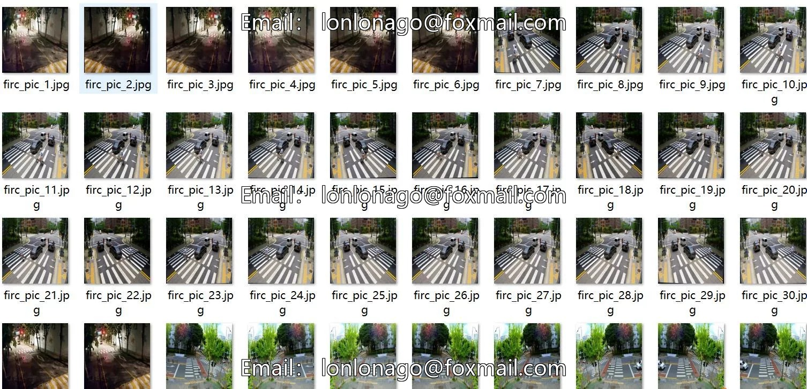
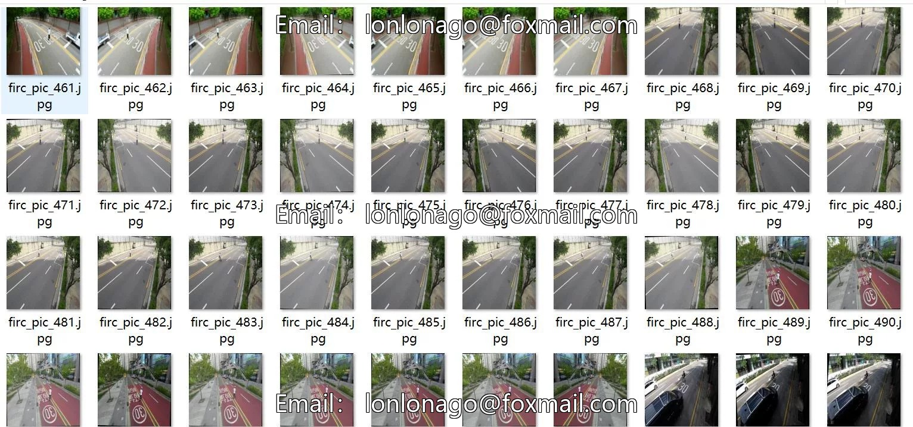
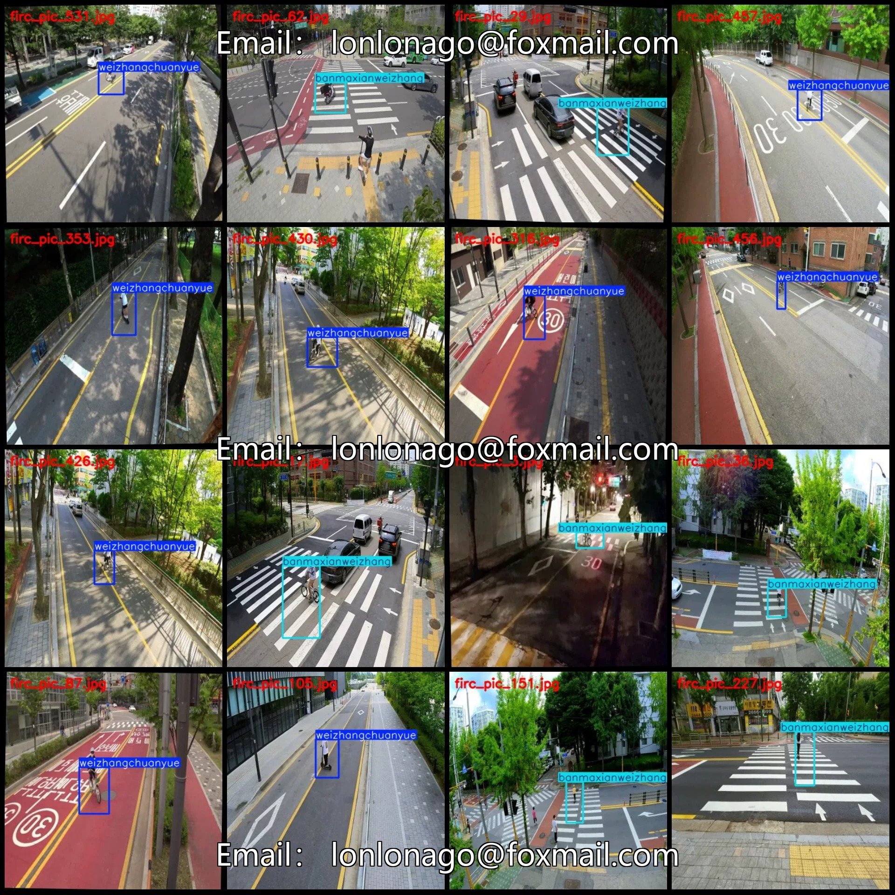
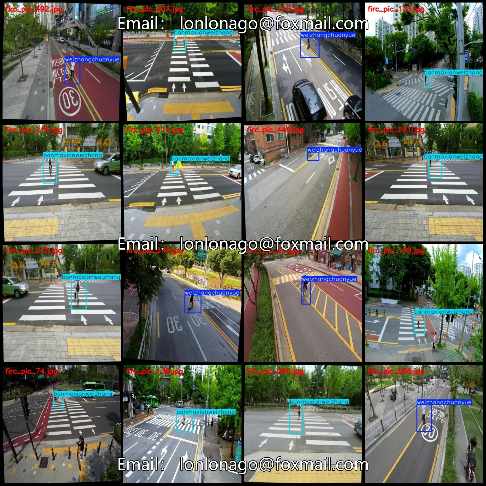

# Pedestrians crossing zebra crossing violation detection dataset VOC+YOLO format 562 images 2 categories

## Body

Pedestrian Crossing Violation Detection Dataset VOC+YOLO Format: 562 Images in 2 Categories with Enhanced
Warm Reminder: Due to the dataset's replicability, please confirm compliance before purchasing.
Note: The dataset contains a significant amount of enhancements, and it is estimated that there are only about 20 original images included.
Dataset Format: Pascal VOC format + YOLO format (txt file without segmentation paths, only containing jpg images along with corresponding VOC format xml files and yolo format txt files)
Number of Images (Total jpg files): 562
Number of Annotations (Total xml files): 562
Number of Annotations (Total txt files): 562
Number of Annotation Categories: 2

Annotation Category Names (Note that the order of categories in the Yolo format does not correspond to this, but is based on the labels folder's classes.txt): ["banmaxianweizhang", "weizhangchuanyue"]
Corresponding Chinese Category Names: ["Zebra Line Traffic Violation", "Traffic Violation Crossing"]
Number of Boxes per Category
"banmaxianweizhang" = 260
"weizhangchuanyue" = 302
Total Boxes = 562
Number of Images per Category
"banmaxianweizhang" = 260

Weizhangchuanyue occupies 302 images
Image resolution: 416x416
Labeling tool used: labelImg
Labeling rules: Draw a rectangle around the category.
Important note: The dataset does not have separate training, validation, and test sets; you need to partition them yourself.
Special statement: This dataset does not guarantee the accuracy of the trained models or weight files.

## Images

## Payment

Here is a pay link on Stripe ( https://buy.stripe.com/3cs8yP7sY87d0vu9AB ). Please contact me lonlonago@foxmail.com after funding $89, and I will send you a complete data files , thank you!

